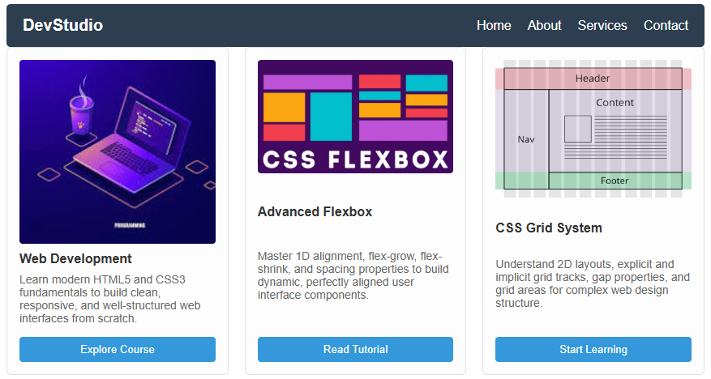
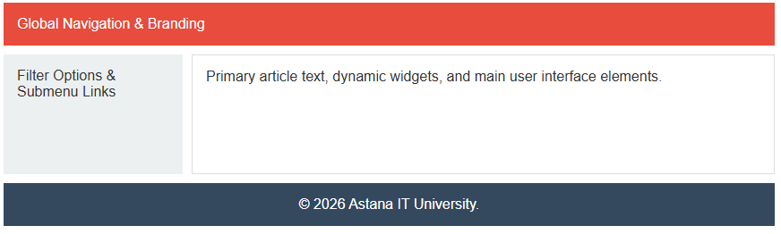
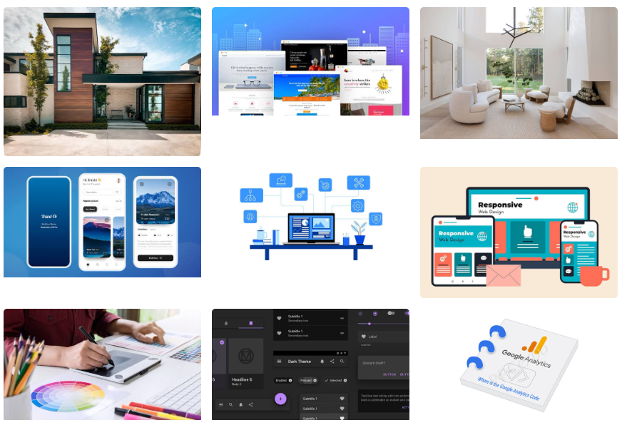
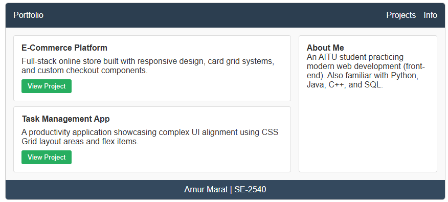

# Assignment #2: Advanced CSS (Flexbox & Grid)

**Name:** Arnur Marat  
**Group:** SE-2540  
**Repository:** Public  

---

## Overview
This repository contains the completed project for Assignment #2 on Advanced CSS layout techniques. The project demonstrates the application of modern CSS layout mechanisms—specifically **Flexbox** and **CSS Grid**—to build complex, responsive web interfaces without relying on legacy floats or third-party frameworks.

---

## Tasks & Implementation Details

### Part 1. Flexbox

#### Task 0. Navigation Bar
- **Description:** Created a header element containing a logo on the left and a list of navigation links on the right.
- **Implementation:** 
  - Applied `display: flex` to the `<header>` element.
  - Used `justify-content: space-between` to separate the logo and navigation items.
  - Aligned elements vertically with `align-items: center`.
  - Added horizontal spacing between links using `gap: 20px`.

#### Task 1. Card Row
- **Description:** Built a row of 3 service/feature cards with consistent structure (image, title, text, action button).
- **Implementation:**
  - Placed cards inside a container with `display: flex` and `gap: 20px`.
  - Ensured equal height for all cards via default `align-items: stretch`.
  - Implemented a hover effect (`transform: translateY(-5px)` and `box-shadow`) for interactive feedback.

---

### Part 2. Grid System

#### Task 2. Page Layout with Grid Areas
- **Description:** Structured a multi-section page layout featuring a header, sidebar, main content area, and footer.
- **Implementation:**
  - Defined parent container as a grid container (`display: grid`).
  - Set explicit columns and rows: `grid-template-columns: 200px 1fr` and `grid-template-rows: auto 1fr auto`.
  - Utilized `grid-template-areas` to assign layout regions (`header`, `sidebar`, `main`, `footer`).

#### Task 3. Image Gallery
- **Description:** Designed an image gallery containing 9 items.
- **Implementation:**
  - Applied `display: grid` with `grid-template-columns: repeat(3, 1fr)` to form a 3x3 layout.
  - Added uniform spacing between images using `gap: 15px`.
  - Created a smooth hover overlay effect displaying image captions upon mouseover using absolute positioning and `opacity` transitions.

---

### Part 3. Combining Flexbox & Grid

#### Task 4. Portfolio Page
- **Description:** Integrated both Flexbox and Grid to build a complete portfolio layout.
- **Implementation:**
  - **Header:** Flexbox for logo and top navigation alignment.
  - **Main Body:** CSS Grid with a 2-column layout (`grid-template-columns: 2fr 1fr`) separating project cards from the sidebar.
  - **Cards:** Flexbox (`flex-direction: column`) inside individual project cards to align headers, text, and action buttons.
  - **Footer:** Full-width footer spanning the bottom of the grid layout.

---

## Project Screenshots

### Task 1 — Card Row

### Task 2 — Page Layout with Grid Areas

### Task 3 — Image Gallery

### Task 4 — Portfolio Page

---

## Work Process Summary

1. **Planning & Structure:** Set up a semantic HTML file (`index.html`) containing distinct sections for each assignment task to keep code clean and readable.
2. **Flexbox Styling:** Applied Flexbox layout properties to handle single-axis alignment (headers and horizontal card layouts), utilizing `gap` and `justify-content` for distribution.
3. **Grid Layouts:** Employed CSS Grid for two-dimensional structures, using `grid-template-areas` for full-page scaffolding and `repeat(3, 1fr)` for structured image grids.
4. **Integration & Finishing:** Combined both layout systems in Task 4 to demonstrate architectural flexibility. Added interactive hover states and ensured spacing consistency across all tasks.